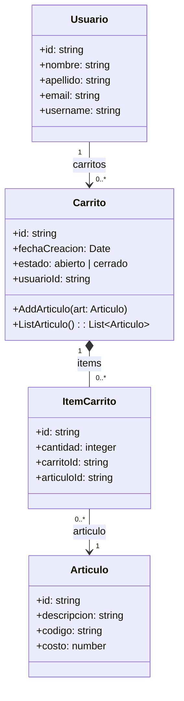

# api-rest-loopback

API REST de un carrito de compras con [LoopBack 4] (Node.js + TypeScript) y en **MongoDB Atlas**.

Trabajo práctico _BackEnd – API REST LoopBack_ - Sistemas Distribuidos
Alumnos: Julián Carmona

---

## 1. Modelo de clases

Se amplió el modelo de la guía (Articulo – Carrito) para representar un carrito que pertenece a un usuario logueado. La lista de artículos del carrito se guarda mediante la clase intermedia `ItemCarrito`, que además registra la **cantidad** de cada artículo.



| Relación LoopBack                                                                            | Clave foránea            |
| -------------------------------------------------------------------------------------------- | ------------------------ |
| `Usuario` **hasMany** `Carrito` (`carritos`) / `Carrito` **belongsTo** `Usuario` (`usuario`) | `Carrito.usuarioId`      |
| `Carrito` **hasMany** `ItemCarrito` (`items`) / `ItemCarrito` **belongsTo** `Carrito`        | `ItemCarrito.carritoId`  |
| `ItemCarrito` **belongsTo** `Articulo` (`articulo`)                                          | `ItemCarrito.articuloId` |

Validaciones: `costo ≥ 0`, `cantidad` entera `≥ 1`, `email` con formato válido, `estado` ∈ {`abierto`, `cerrado`}. No se pueden agregar artículos a un carrito cerrado.

## 2. Arquitectura en capas

```
src/
├── controllers/   → capa REST (endpoints)
├── repositories/  → acceso a datos, una por modelo
├── models/        → clases del dominio
└── datasources/   → conexión a MongoDB (mongo.datasource.ts)
```

## 3. Endpoints

| Recurso                | Endpoints                                                                                                                |
| ---------------------- | ------------------------------------------------------------------------------------------------------------------------ |
| Artículos              | `POST/GET/PATCH /articulos`, `GET /articulos/count`, `GET/PATCH/PUT/DELETE /articulos/{id}`                              |
| Usuarios               | `POST/GET/PATCH /usuarios`, `GET /usuarios/count`, `GET/PATCH/PUT/DELETE /usuarios/{id}`                                 |
| Carritos               | `POST/GET/PATCH /carritos`, `GET /carritos/count`, `GET/PATCH/PUT/DELETE /carritos/{id}`                                 |
| Carritos de un usuario | `GET/POST/PATCH/DELETE /usuarios/{id}/carritos`                                                                          |
| Usuario de un carrito  | `GET /carritos/{id}/usuario`                                                                                             |
| **AddArticulo**        | `POST /carritos/{id}/articulos` → body `{"articuloId": "...", "cantidad": 2}` (si el artículo ya está, suma la cantidad) |
| **ListArticulo**       | `GET /carritos/{id}/articulos` → artículos, cantidad, subtotal y total                                                   |
| Quitar artículo        | `DELETE /carritos/{id}/articulos/{articuloId}`                                                                           |

Toda la documentación interactiva (OpenAPI / Swagger) está en **http://localhost:3000/explorer**.

## 4. Cómo ejecutarlo

Requisitos: Node.js 20, 22 o 24.

```bash
npm install
cp .env.example .env        # en Windows: copy .env.example .env
# editar .env y pegar la URL de MongoDB Atlas
npm start
```

Abrir http://localhost:3000 → _explorer_.

> El archivo `.env` está en `.gitignore`: la contraseña de Atlas **no** se sube al repositorio.

---

# Guía de resolución del práctico

## Ejercicio 1 — Instalación y bases del backend

**Tareas iniciales**

1. Crear el proyecto `api-rest-loopback` en GitLab y clonarlo con _Open in your IDE → Visual Studio Code (HTTPS)_.
2. Instalar el CLI de LoopBack. ⚠️ **Usar la versión 7**: la 8.0.0 (publicada en octubre 2026) genera un `package.json` con dependencias incompatibles y `npm install` falla con `ERESOLVE`.
   ```bash
   npm i -g @loopback/cli@7
   ```

**Comandos que se usaron** (respuestas a cada pregunta del CLI):

| Comando             | Respuestas                                                                                                                                                                                                                                                   |
| ------------------- | ------------------------------------------------------------------------------------------------------------------------------------------------------------------------------------------------------------------------------------------------------------ |
| `lb4 app`           | nombre `api-rest-loopback`; dejar todas las opciones por defecto (eslint, prettier, mocha, loopbackBuild, vscode)                                                                                                                                            |
| `lb4 model` ×4      | Clase base **Entity**, sin propiedades libres. Propiedades: ver sección 1 (`id` string, _id: sí_, _generado: sí_)                                                                                                                                            |
| `lb4 datasource`    | nombre `mongo`, conector **MongoDB**, url vacía (se lee de `.env`), database `api_rest_loopback`                                                                                                                                                             |
| `lb4 repository`    | datasource `MongoDatasource`, seleccionar los 4 modelos, clase base `DefaultCrudRepository`                                                                                                                                                                  |
| `lb4 relation` ×5   | `belongsTo` Carrito→Usuario (`usuarioId`), `hasMany` Usuario→Carrito (`carritos`), `belongsTo` ItemCarrito→Carrito (`carritoId`), `hasMany` Carrito→ItemCarrito (`items`), `belongsTo` ItemCarrito→Articulo (`articuloId`). Incluir _inclusion resolver_: sí |
| `lb4 controller` ×3 | _REST Controller with CRUD functions_ para Articulo (`/articulos`), Usuario (`/usuarios`) y Carrito (`/carritos`); id `id` tipo `string`, _omitir id al crear_: sí                                                                                           |

Después de generar se ajustó a mano:

- `src/datasources/mongo.datasource.ts`: la URL se lee de `process.env.MONGODB_URL` (paquete `dotenv`).
- `src/models/*.ts`: validaciones y claves foráneas obligatorias.
- `src/controllers/carrito-articulo.controller.ts`: controlador propio con `AddArticulo` / `ListArticulo`.

**MongoDB Atlas**

1. Crear cuenta en https://www.mongodb.com/cloud/atlas (con Gmail) y un proyecto, p. ej. `MongoApiRest`.
2. Crear un cluster gratuito (**M0 / Free**) en Google Cloud.
3. **Database Access** → crear un usuario de base de datos con contraseña (anotarla).
4. **Network Access** → _Add IP Address_ → _Allow access from anywhere_ (`0.0.0.0/0`). Sin este paso la API no conecta y da timeout.
5. **Connect → Drivers → Node.js** → copiar la URL `mongodb+srv://...`, pegarla en `.env` reemplazando `<usuario>` y `<password>`.
6. `npm start` y verificar http://localhost:3000/ping.

## Ejercicio 2 — Probar la API desde OpenAPI (explorer)

En http://localhost:3000/explorer, usar _Try it out_ en este orden y guardar los `id` que devuelve cada respuesta:

1. `POST /usuarios`
   ```json
   {
     "nombre": "Julián",
     "apellido": "Carmona",
     "email": "julian@example.com",
     "username": "jcarmona"
   }
   ```
2. `POST /articulos` (dos o tres veces)
   ```json
   {
     "descripcion": "Mantequilla de maní 500g",
     "codigo": "MM-500",
     "costo": 4500
   }
   ```
   ```json
   {"descripcion": "Barra proteica", "codigo": "BP-01", "costo": 1200}
   ```
3. `POST /usuarios/{id}/carritos` con el id del usuario y body `{}` → crea el carrito del usuario.
4. `POST /carritos/{id}/articulos` con el id del carrito:
   ```json
   {"articuloId": "<id del artículo>", "cantidad": 2}
   ```
5. `GET /carritos/{id}/articulos` → lista con subtotales y total.
6. `GET /carritos/{id}` con el filtro:
   ```json
   {
     "include": [
       {"relation": "usuario"},
       {"relation": "items", "scope": {"include": [{"relation": "articulo"}]}}
     ]
   }
   ```
7. Casos de error para mostrar: `POST /articulos` con `"costo": -5` → **422**; `PATCH /carritos/{id}` con `{"estado": "cerrado"}` y luego intentar agregar un artículo → **422**.

## Ejercicio 3 — Verificar los datos con MongoDB Compass

1. Instalar Compass: https://www.mongodb.com/products/compass
2. _New connection_ → pegar la misma URL de `.env` → _Connect_.
3. Abrir la base `api_rest_loopback`: deben aparecer las colecciones **Usuario**, **Articulo**, **Carrito** e **ItemCarrito** con los documentos cargados desde el explorer.
4. Comprobar que `Carrito.usuarioId` e `ItemCarrito.carritoId/articuloId` coinciden con los `_id` de los documentos relacionados.

## Ejercicio 4 — Clase Usuario + controlador

Ya incluido: modelo `src/models/usuario.model.ts`, repositorio `UsuarioRepository`, controlador CRUD `src/controllers/usuario.controller.ts` y los controladores de relación `usuario-carrito` y `carrito-usuario`. Se prueba desde el explorer con los pasos 1, 3 y 6 del Ejercicio 2, más `GET /usuarios/{id}/carritos`.
