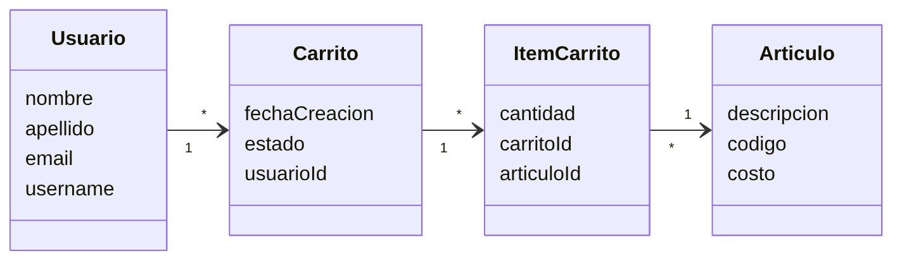
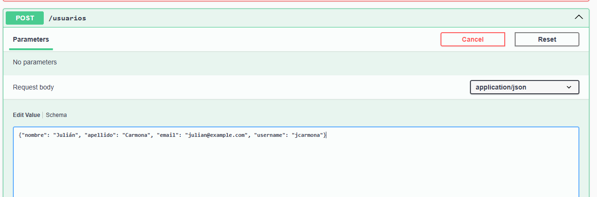
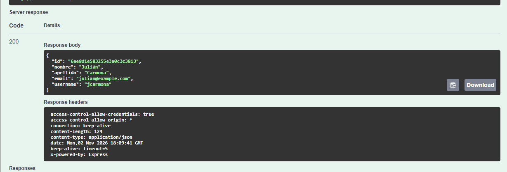
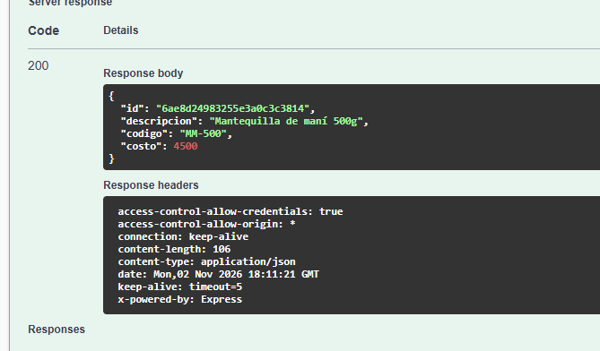
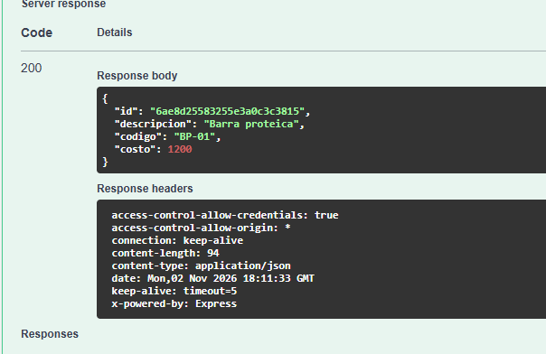
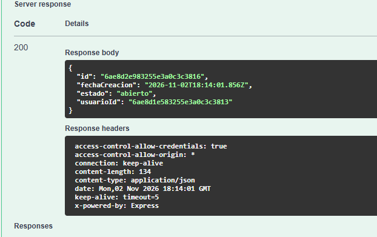
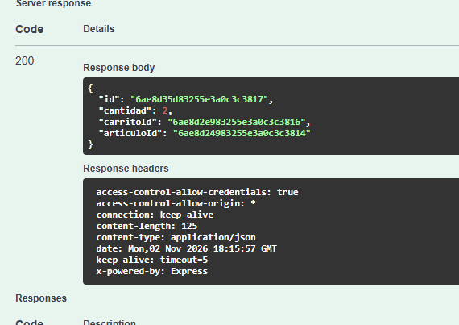
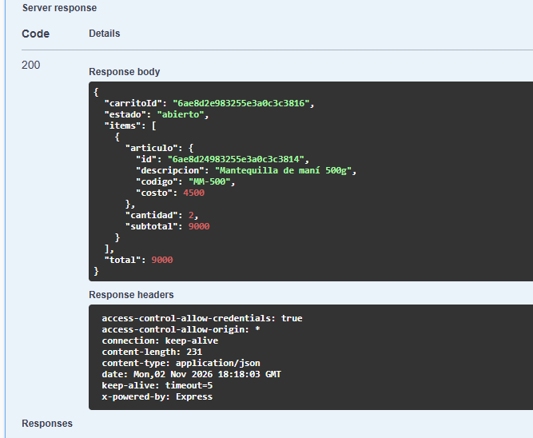
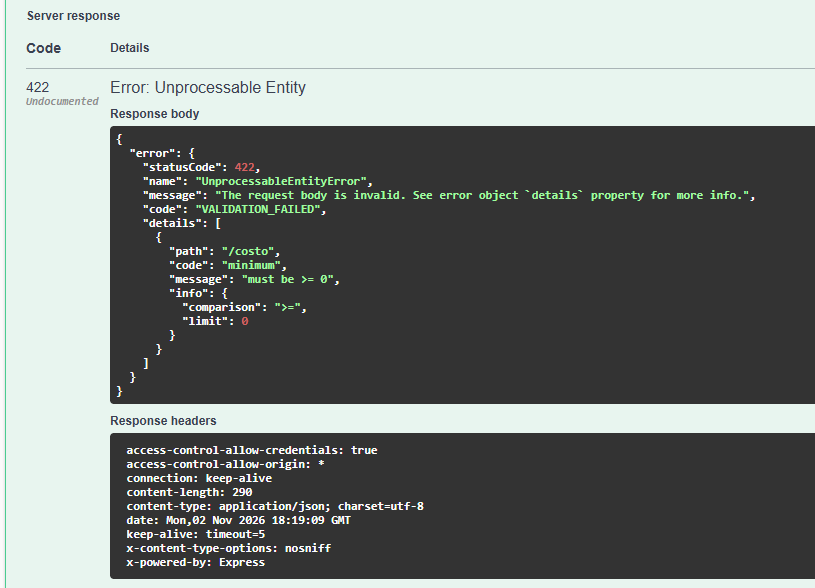
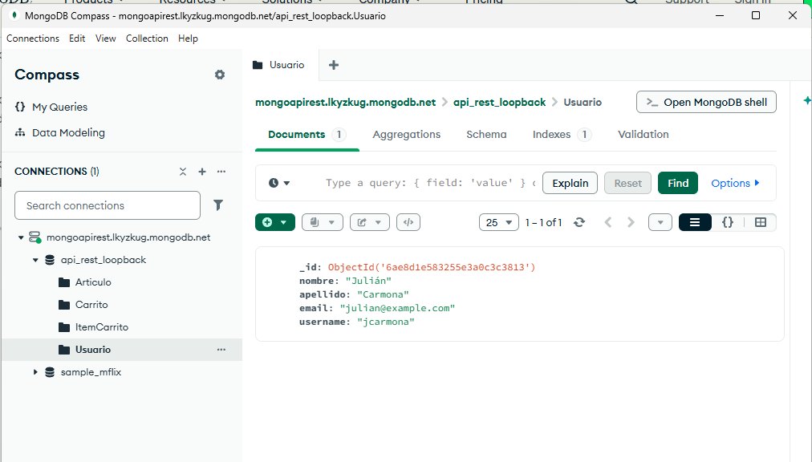

# API REST con LoopBack 4

Backend de un carrito de compras hecho con **LoopBack 4** (Node.js + TypeScript) y **MongoDB Atlas**.

### Alumnos:
- Julián Carmona
- Damian Joannas
- Mateo Flegler

## Modelo



Un usuario tiene carritos, y cada carrito guarda sus artículos con la cantidad en `ItemCarrito`.

## Cómo ejecutarlo

```bash
npm install
copy .env.example .env    # pegar la URL de MongoDB Atlas en MONGODB_URL
npm start
```

Abrir http://localhost:3000/explorer

## Flujo de prueba

### 1. Crear un usuario — `POST /usuarios`




### 2. Crear artículos — `POST /articulos`




### 3. Crear el carrito del usuario — `POST /usuarios/{id}/carritos`

El carrito queda asociado al usuario por `usuarioId`.



### 4. Agregar un artículo al carrito — `POST /carritos/{id}/articulos`



### 5. Ver el carrito — `GET /carritos/{id}/articulos`

Devuelve los artículos con su cantidad, subtotal y el total.



### 6. Validación — artículo con costo negativo

La API rechaza el dato con **422 Unprocessable Entity**.



### 7. Datos guardados en MongoDB (Compass)

La base `api_rest_loopback` tiene una colección por modelo.


